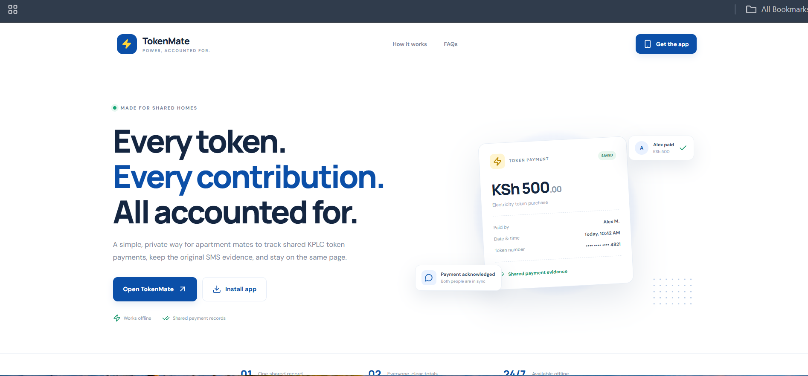
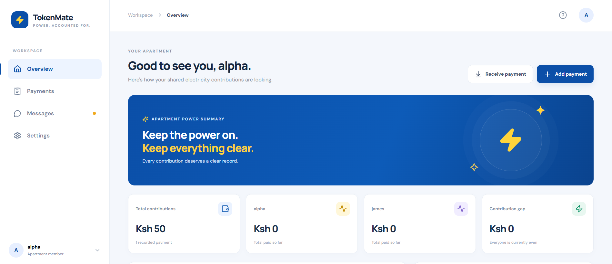
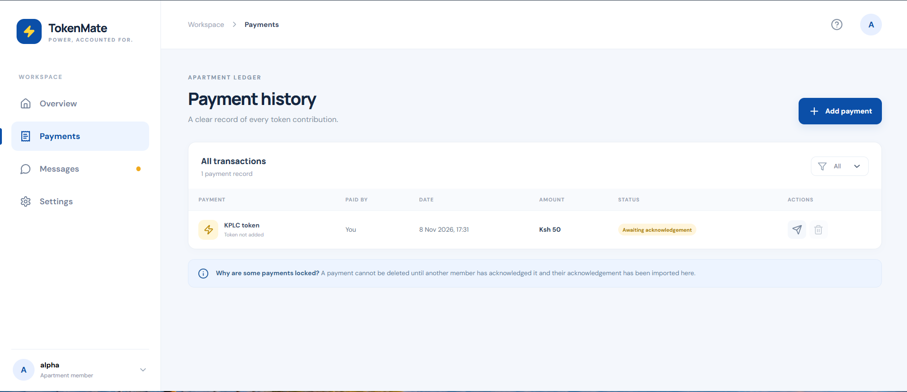
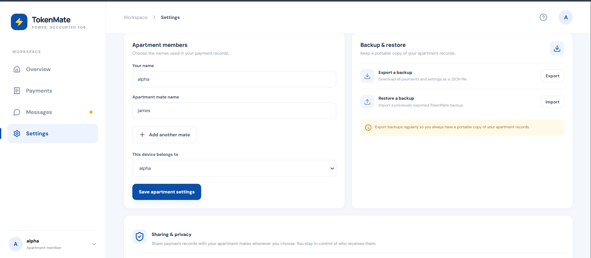

# TokenMate — Shared KPLC Token Tracker

A React PWA for apartment mates to record, review and exchange prepaid electricity token payment evidence.

Live app: https://tokenmate.vercel.app/

## Screenshots

| Landing | Overview | Payments | Settings |
|---------|----------|----------|----------|
|  |  |  |  |

## Features in this MVP
- Responsive landing page and app dashboard.
- Installable PWA with offline app-shell caching.
- Add your own name, your apartment mate's name and any additional apartment mates.
- Settings toggle to enable message access for pasted or imported KPLC SMS messages.
- Automatic extraction of amount, token number, units (kWh) and date from imported or pasted SMS.
- Token insights in Overview: average purchase amount, average token rate (KSh/kWh when units are available) and a rising/steady/dropping trend.
- Manual payment entry, KSh 25 minimum and quick amount presets.
- Paste KPLC SMS and attempt to extract amount, token number and date. Always review extracted values.
- Payment history, per-person totals and contribution difference.
- Preview original SMS evidence.
- Share payment packages with any apartment mate using the device share sheet when supported; fallback downloads JSON and opens WhatsApp with a message to attach it.
- Receive/import payment JSON and export an explicit acknowledgement JSON, so mates can share payments with you and you can share yours with them.
- Sender imports acknowledgement; only acknowledged payments can be deleted.
- Export/restore JSON backups.

## Requirements
- Node.js 18+ (Node 20 LTS recommended)
- npm

## Run locally
```bash
cd tokenmate
npm install
npm run dev
```
Open the local URL printed by Vite. To test PWA install/offline behavior, use a production build served over localhost:

```bash
cd tokenmate
npm run build
npm run preview
```

## Install as an app

TokenMate ships as an installable PWA and as an Android Trusted Web Activity (TWA) package.

- **Web/PWA:** open https://tokenmate.vercel.app/ in Chrome, Edge or Safari, then choose **Install app** or **Add to Home Screen**. The installed app opens standalone and keeps working offline.
- **Android APK:** download [`TokenMate.apk`](tokenmate/public/downloads/TokenMate.apk), or use the **Get the app** button on an Android device. Android may ask you to allow installs from the browser.
- **Google Play:** upload `tokenmate/packages/google-play/TokenMate.aab` in Play Console. The Android package name is `app.vercel.tokenmate.twa`.

TWA verification uses `tokenmate/public/.well-known/assetlinks.json`, served at `https://tokenmate.vercel.app/.well-known/assetlinks.json`. Keep its SHA-256 fingerprint in sync with the signing certificate, especially when Play App Signing is enabled—use the Play Console fingerprint instead of the local keystore fingerprint.

Signing material (`signing.keystore`, `signing-key-info.txt`) is intentionally not committed. Back it up securely.

## Test the apartment workflow
1. On Device A, open Settings and add your name, your apartment mate's name and any other apartment mates. Select the current device owner.
2. Add a payment. Paste a sample KPLC SMS or enter the details manually.
3. Open Payments or Messages and press Share. If your browser supports file sharing, select WhatsApp from the share sheet. Otherwise, TokenMate downloads a `.json` payment package and opens WhatsApp with a message; attach the downloaded JSON file yourself.
4. On Device B, open Receive payment, paste the JSON package contents or choose the downloaded JSON file, preview it, then import it.
5. On Device B, open Messages → Received payments → Acknowledge & export. Send the downloaded acknowledgement JSON back to Device A (WhatsApp can be used to send the file).
6. On Device A, open Receive payment, paste/select the acknowledgement JSON and import it. The original payment is now acknowledged and can be deleted.

The same flow works in either direction and with any number of apartment mates.

## Important limitations
- A normal web PWA cannot silently read the phone's SMS inbox. Users must paste a copied SMS or import a text file. Native SMS reading would require a separately built Android application with appropriate permissions and store-policy review.
- WhatsApp does not expose read receipts to this app. Only the explicit in-app acknowledgement package changes a payment to acknowledged.
- The acknowledgement package is a workflow confirmation, not cryptographic proof of identity or proof that KPLC issued the payment. A user could fabricate or edit a JSON file. Production-grade trust would require authentication and a backend or cryptographic identity/signature system.
- The SMS parser is a best-effort starter parser; KPLC SMS formats can vary. Always verify the amount, token and date before saving.
- The Google Fonts import is optional; offline use falls back to system fonts if the font was not previously cached.

## Suggested next improvements
1. Add sample SMS fixtures from real KPLC message formats and test the parser against them.
2. Add QR transfer for small payloads, plus a stronger signed acknowledgement protocol.
3. Add CSV export and transaction edit/audit history.
4. Add Android share-target integration or a native Android companion if direct SMS import is essential.
5. Add end-to-end automated tests for payment parsing, import validation and acknowledgement state transitions.
